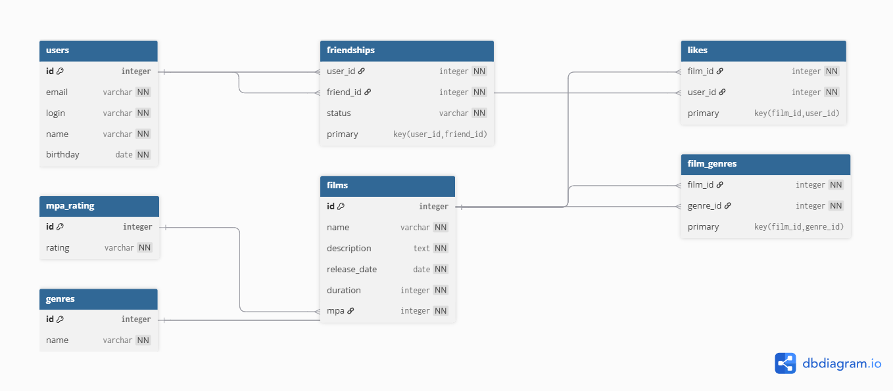

# Filmorate

## Database ER Diagram



Filmorate is a social service for rating movies and interacting with other users.

## Main Database Tables

- `users` — stores user information
- `films` — movies with descriptions, duration, and MPA ratings
- `mpa_rating` — age ratings (G, PG, PG-13, R, NC-17)
- `genres` — movie genres
- `film_genres` — many-to-many relationship between films and genres
- `likes` — user likes for movies
- `friendships` — friendship relationships between users with statuses (`PENDING`, `CONFIRMED`)

## Example SQL Queries

### Get all films with the "Comedy" genre

```sql
SELECT f.*
FROM films f
JOIN film_genres fg ON f.id = fg.film_id
JOIN genres g ON fg.genre_id = g.id
WHERE g.name = 'Comedy';
```
Get films liked by user with id = 1
```sql
SELECT f.*
FROM films f
JOIN likes l ON f.id = l.film_id
WHERE l.user_id = 1;
```
Get confirmed friends of user with id = 1
```sql
SELECT u.*
FROM users u
JOIN friendships f ON u.id = f.friend_id
WHERE f.user_id = 1 AND f.status = 'CONFIRMED';
```
Get top 10 films by number of likes
```sql
SELECT f.*, COUNT(l.user_id) AS likes_count
FROM films f
LEFT JOIN likes l ON f.id = l.film_id
GROUP BY f.id
ORDER BY likes_count DESC
LIMIT 10;
```
